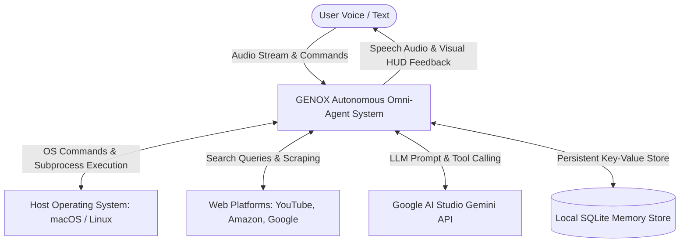
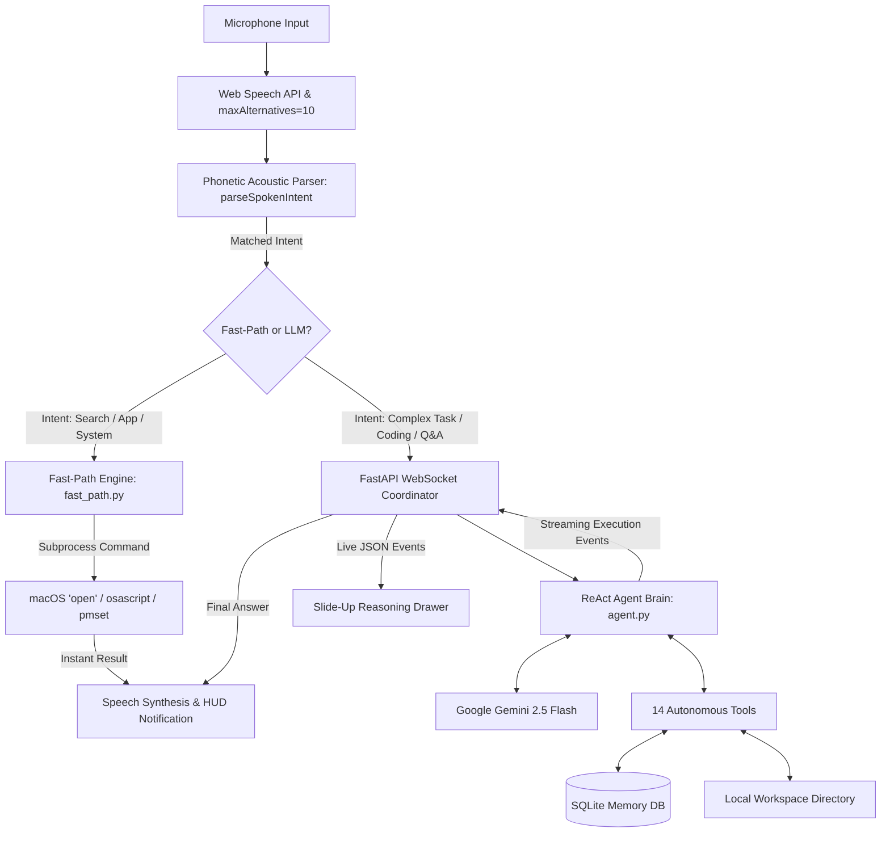
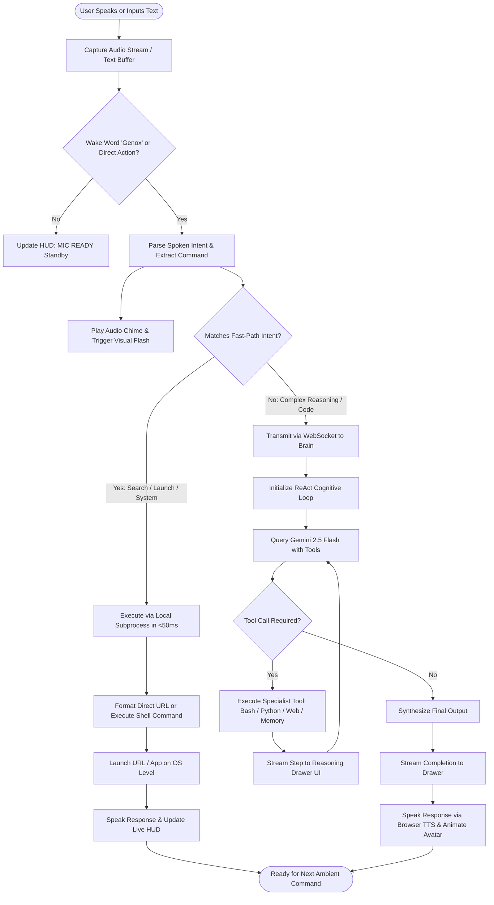
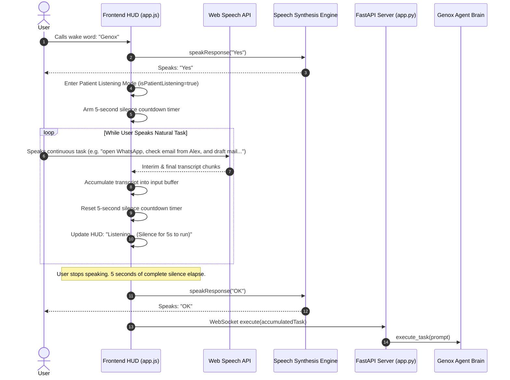
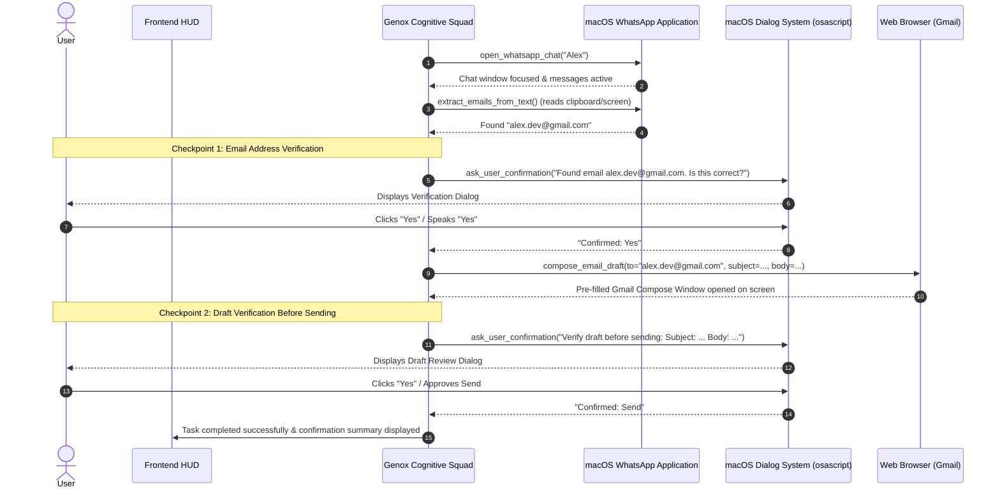
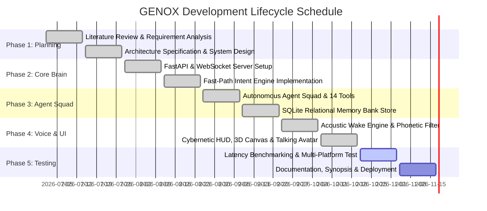

# PROJECT SYNOPSIS

---

## 1. Title/Topic of the Project

**Title:**  
# GENOX: Autonomous Multi-Agent Ambient Operating System Companion & Voice-Driven Cybernetic Command Center

**Domain / Specialization:**  
Artificial Intelligence (AI), Natural Language Processing (NLP), Autonomous Multi-Agent Systems, Human-Computer Interaction (HCI), Edge & Operating System Automation.

**Nature of the Project:**  
Applied Research, Software Engineering & System Architecture.

---

## 2. Problem Statement

Modern computing environments require users to constantly juggle disparate software applications, browser tabs, command-line interfaces, and web tools to complete everyday tasks. While conversational AI systems (e.g., Apple Siri, Amazon Alexa, Google Assistant) have popularized voice interfaces, they suffer from fundamental limitations:
1. **Rigid, Closed-Domain Capabilities:** Commercial voice assistants rely on hardcoded intents and cannot perform deep, multi-step problem solving, arbitrary code execution, or autonomous web research.
2. **Slow, Cost-Heavy LLM Architectures:** Emerging autonomous agents (e.g., AutoGPT, CrewAI, LangChain agents) rely exclusively on large language model (LLM) reasoning loops for every request. Even trivial queries (such as *"open YouTube and search valorant"* or *"what is my battery level"*) trigger multi-step token generations, introducing 10–30 second latency penalties and escalating API costs.
3. **Phonetic Recognition Fragility:** Commercial Speech-to-Text (STT) models do not recognize custom agent names (such as **"Genox"**) out-of-the-box, phonetically misinterpreting user wake calls as *"The knocks"*, *"Linux"*, *"Can ox"*, or *"Gen-X"*, causing silent wake failures and poor user adoption.
4. **Lack of Ambient, Real-Time Interfaces:** Existing AI agent interfaces are predominantly plain text consoles or generic chatbot wrappers. They lack real-time audio visualization, hardware telemetry monitoring, and tactile, low-latency visual feedback.

**GENOX** directly addresses these challenges by introducing a **hybrid dual-path architecture**: combining an ambient, hands-free acoustic wake engine, a sub-50ms deterministic local intent router, an autonomous 6-agent cognitive squad powered by zero-cost Google Gemini models, and a high-performance cybernetic command center interface.

---

## 3. Objective and Scope of the Project

### 3.1 Primary Objectives
- **Ambient Hands-Free Voice Activation & Patient Turn-Taking:** Implement an always-listening wake word detector triggered by *"Genox"* or *"Hey Genox"*. When addressed, Genox verbally replies *"Yes"*, transitions into a **Patient Listening Mode** that accumulates the user's complete, natural speech without cutting off mid-sentence, and executes automatically only when **5 seconds of silence** elapse, confirming with *"OK"* before starting the task.
- **Cross-Application Desktop Autopilot (WhatsApp, Mail, Browser, Apps):** Equip Genox with deep macOS GUI automation and inter-app scripting (AppleScript, keystrokes, clipboard management, window focus) to perform complex multi-app tasks, such as opening WhatsApp, finding contacts, extracting received email addresses, drafting emails in Gmail or Apple Mail, and executing workflows across any software.
- **Human-in-the-Loop Interactive Verification Protocol:** Integrate native macOS confirmation dialogs (`ask_user_confirmation`) and interactive HUD cards to verify sensitive actions with the user (e.g. confirming found email addresses and reviewing email drafts before sending).
- **Sub-50ms Fast-Path Execution Engine:** Develop a deterministic local router that intercepts high-frequency intents (multi-platform search across YouTube, Amazon, Google, Spotify, GitHub, Reddit; launching local macOS applications; system hardware queries) and executes them in under 50 milliseconds without LLM latency.
- **Autonomous Multi-Agent Squad (6 Specialists & 25 Tools):** Construct an orchestrated squad of specialized sub-agents (Coding, Research, Browser, System, Vision, and Memory) equipped with 25 autonomous tools executing sandboxed code, terminal commands, web crawling, messaging, and screen perception.
- **Persistent Long-Term Relational Memory:** Build an embedded SQLite memory matrix (`genox_memory.db`) that autonomously stores, recalls, and updates contextual facts and user preferences across system reboots.
- **Zero-Cost Enterprise-Grade Cognition:** Seamlessly integrate the Google AI Studio Gemini API (`gemini-2.5-flash` / `gemini-2.0-flash` / `gemini-3.1-flash-lite`) utilizing free-tier quotas with zero internal reflection latency (`thinking_budget=0`).
- **Cybernetic Glassmorphic HUD:** Engineer an ultra-smooth 60 FPS Canvas 2D/3D particle AI Core, an audio-reactive talking holographic avatar face, live microphone visualizers, and an interactive slide-up reasoning drawer.

### 3.2 Scope of the Project
- **In-Scope:**
  - Full local operating system automation on macOS (with cross-compatibility for Linux).
  - Hands-free, real-time voice wake detection and speech synthesis using standard web standards.
  - Multi-platform direct search synthesis across 9+ global web platforms.
  - Autonomous ReAct (Reasoning + Acting) execution loops with live WebSocket event streaming.
  - Local sandboxed file system creation, modification, and execution in `/workspace`.
  - Air-gapped, privacy-preserving execution on `127.0.0.1`.
- **Out-of-Scope / System Boundaries:**
  - Physical hardware robotics and embodied kinematics.
  - Multi-tenant cloud hosting (designed as a single-user personal workstation command center).
  - Telephony or cellular SMS gateways.

---

## 4. Methodology & Process Description

### 4.1 System Methodology
The project follows an **Iterative Prototyping & Hybrid Modular Architecture**:
1. **Perception Layer:** The browser captures ambient microphone streams, applying continuous Web Speech API analysis and Web Audio frequency extraction.
2. **Phonetic Evaluation Layer:** Transcripts are evaluated against a 40+ phonetic acoustic dictionary across up to 10 alternative candidate streams (`maxAlternatives = 10`).
3. **Dual-Path Decision Routing:**
   - **Path 1 (Deterministic Fast-Path):** Matches system commands, app launches, and multi-platform queries, executing directly via operating system subprocesses in `<50ms`.
   - **Path 2 (Cognitive LLM Pipeline):** For open-ended queries or coding tasks, dispatches the prompt over WebSockets to the FastAPI coordinator, triggering the 6-agent squad and streaming live reasoning steps back to the user interface.
4. **Action & Execution Layer:** The sandboxed toolset executes Python code, terminal commands, SQLite operations, or web scraping.
5. **Synthesis & Feedback Layer:** Generates spoken audio responses via the browser's speech synthesis engine while pulsing the holographic avatar face in real time.

---

### 4.2 Data Flow Diagrams (DFD)

#### Data Flow Diagram — Level 0 (Context Diagram)

#### Data Flow Diagram — Level 1 (Subsystem Decomposition)

---

### 4.3 Flowchart of the Dual-Path Execution Pipeline

---

### 4.4 UML Sequence Diagram: Patient Voice Listening & Turn-Taking Flow

### 4.5 UML Sequence Diagram: Cross-App Desktop Autopilot with Human Confirmation

---

## 5. Resources and Limitations (Hardware & Software)

### 5.1 Hardware Requirements
| Component | Minimum Specification | Recommended Specification |
| :--- | :--- | :--- |
| **Processor** | Dual-Core 2.0 GHz x86_64 or Apple Silicon M1 | Apple Silicon M1 / M2 / M3 / M4 or Intel Core i7 / AMD Ryzen 7 |
| **Random Access Memory (RAM)** | 8 GB LPDDR4 / DDR4 | 16 GB Unified Memory / DDR5 |
| **Storage (ROM/SSD)** | 500 MB Free Disk Space | 2 GB NVMe SSD (for logs, SQLite memory, and workspace files) |
| **Audio Input** | Integrated Laptop Microphone | Dual-Array Noise-Cancelling Microphone or Headset |
| **Audio Output** | Standard Stereo Speakers | High-Definition Speakers or Headphones |
| **Network Interface** | Standard Broadband / Wi-Fi (1 Mbps) | High-Speed Low-Latency Internet (10+ Mbps) |

### 5.2 Software Requirements
| Category | Tool / Package Name | Version / Specification |
| :--- | :--- | :--- |
| **Operating System** | macOS (Ventura, Sonoma, Sequoia) or Linux | macOS 14.0+ (Tested on macOS Darwin 24.3.0) |
| **Runtime Environment** | Python | Python 3.11 or Python 3.12 (CPython) |
| **Web Browser** | Google Chrome / Chromium-based Browser | Version 120.0+ (with Web Speech API enabled) |
| **Backend Framework** | FastAPI & Uvicorn | `fastapi>=0.115.0`, `uvicorn>=0.32.0` |
| **Communication Protocol** | WebSockets | `websockets>=13.0`, Native HTML5 WebSocket |
| **AI SDK & Model** | Google GenAI SDK | `google-genai>=1.0.0` (Gemini 2.5 Flash / 2.0 Flash) |
| **Database Engine** | SQLite3 | Embedded SQLite 3.40+ (`genox_memory.db`) |
| **Frontend Technologies** | Vanilla Web Stack | HTML5, Modern CSS3 (Variables & Glassmorphism), ES6 JavaScript |
| **Web Graphics & Audio** | Browser APIs | HTML5 Canvas 2D/3D, Web Audio API (`AnalyserNode`), Web Speech API |

### 5.3 Limitations of the Proposed System
1. **Browser Speech API Tethering:** The continuous ambient voice listener relies on Chromium's native implementation of the Web Speech API (`webkitSpeechRecognition`). In headless environments without a browser window, voice recognition must fall back to manual text input or local microphone capture.
2. **Cloud API Dependency for Complex Reasoning:** While fast-path tasks run 100% locally on the device, complex multi-step reasoning requires connectivity to the Google AI Studio Gemini API endpoint.
3. **Single-Workstation Concurrency:** The architecture is designed for a single active developer/user workstation; multi-tenant enterprise orchestration is not currently implemented.
4. **Third-Party Rate Limits:** While operating on Google AI Studio's 100% free tier, usage is governed by Google's free-tier rate limits (15 RPM / 1,500 RPD), mitigated by the Fast-Path Router which bypasses the LLM for everyday commands.

---

## 6. Application and Future Scope of the Project

### 6.1 Real-World Applications
- **Hands-Free Developer Operating System Copilot:** Programmers can dictate tasks, launch servers, run test suites, search documentation on GitHub, and inspect terminal status without taking their hands off the keyboard or switching IDE tabs.
- **Ambient Smart Home & Workstation Controller:** Instantaneous voice querying of system health, battery metrics, audio volume, media playback (Spotify/YouTube), and web shopping (Amazon).
- **Accessibility & Motor Impairment Assistive Technology:** Provides users with physical disabilities full computational autonomy over their operating system, file operations, web research, and application management via voice commands.
- **Autonomous Multi-Source Research Tool:** Automatically synthesizes complex technical topics by searching across DuckDuckGo, Wikipedia, and live web pages, compiling citations directly into local markdown files.

### 6.2 Future Scope & Planned Enhancements
- **On-Device Offline STT & TTS (Whisper & Piper):** Incorporate local edge models (e.g., OpenAI Whisper Small and Piper TTS) to enable 100% air-gapped voice recognition and synthesis without relying on Google's speech servers.
- **Local LLM Edge Fallback (Ollama / Llama.cpp):** Integrate local quantization models (e.g., Llama 3 8B, DeepSeek-R1) to allow reasoning during complete network blackouts.
- **Vision Perception Camera Stream:** Extend the Vision Agent to inspect real-time webcam video feeds for facial recognition, gesture controls, and document scanning.
- **Native OS Tray Application (Tauri / Electron):** Package the web command center into a lightweight, native cross-platform desktop application with global system hotkeys (`⌘+Space`) and background daemon persistence.

---

## 7. Project Timeline (Gantt Chart & PERT Chart)

### 7.1 Gantt Chart (14-Week Development Lifecycle)

### 7.2 PERT / Milestone Critical Path Table
| Milestone ID | Task Description | Predecessor | Duration | Status |
| :--- | :--- | :--- | :--- | :--- |
| **M1** | System Requirements & Architectural Specification | None | 2 Weeks | **Completed** |
| **M2** | FastAPI Backend & WebSocket Stream Gateway | M1 | 2 Weeks | **Completed** |
| **M3** | Fast-Path Sub-50ms Multi-Platform Router | M2 | 2 Weeks | **Completed** |
| **M4** | ReAct Multi-Agent Squad & 14 Autonomous Tools | M3 | 2 Weeks | **Completed** |
| **M5** | SQLite Long-Term Memory Relational Store | M4 | 2 Weeks | **Completed** |
| **M6** | Hands-Free Ambient Acoustic Wake Engine (40+ Phonemes)| M5 | 2 Weeks | **Completed** |
| **M7** | 60 FPS Canvas HUD, Talking Hologram & Voice Visualizer| M6 | 2 Weeks | **Completed** |
| **M8** | Rigorous Latency Benchmarking & Final Academic Synopsis| M7 | 2 Weeks | **In Progress** |

---

## 8. Conclusion & Innovation

The **GENOX** project represents a significant technological leap in personal workstation computing and human-agent interaction. By eliminating the false dichotomy between simple voice assistants and slow, expensive autonomous agents, GENOX introduces a **unified, dual-path architecture**:

### Key Innovations that Set GENOX Apart:
1. **Sub-50ms Deterministic Intent Bypassing:** Rather than squandering computational resources and user patience sending commands like *"open YouTube and search valorant"* or *"open Amazon and search shoes"* through high-latency LLM generation loops, GENOX intercepts them deterministically, synthesizing direct platform queries and launching them in under 50 milliseconds.
2. **Fuzzy Multi-Candidate Acoustic Wake Architecture:** Overcoming standard commercial STT vocabulary blind spots, GENOX's clustered phonetic matching engine inspects 10 speech hypotheses concurrently, ensuring reliable activation across global accents without requiring user profile training.
3. **Zero-Cost Cognitive Deployment:** Through thoughtful optimization of Google AI Studio's Gemini 2.5 Flash pipeline and elimination of internal reflection tokens (`thinking_budget=0`), GENOX provides high-intelligence autonomous reasoning with zero ongoing operational costs.
4. **Futuristic Cybernetic Glassmorphic Ergonomics:** Replacing static chat forms with an ambient, hardware-monitored command center featuring a 60 FPS 3D particle torus, an audio-modulated voice frequency spectrum, and a synchronized talking holographic avatar.

In summary, GENOX delivers an ambient, highly responsive, and functionally autonomous operating system companion that delivers on the long-promised vision of an intelligent, personal "Jarvis" on local hardware.

---

## 9. References & Bibliography

### 9.1 Academic & Research Papers
1. **Vaswani, A., Shazeer, N., Parmar, N., Uszkoreit, J., Jones, L., Gomez, A. N., Kaiser, Ł., & Polosukhin, I.** (2017). *Attention Is All You Need*. Advances in Neural Information Processing Systems (NeurIPS 2017), 30, 5998–6008. https://arxiv.org/abs/1706.03762
2. **Yao, S., Zhao, J., Yu, D., Du, N., Shafran, I., Narasimhan, K., & Cao, Y.** (2022). *ReAct: Synergizing Reasoning and Acting in Language Models*. International Conference on Learning Representations (ICLR 2023). https://arxiv.org/abs/2210.03629
3. **Schick, T., Dwivedi-Yu, J., Dessì, R., Raileanu, R., Lomeli, M., Zettlemoyer, L., Cancedda, N., & Scialom, T.** (2023). *Toolformer: Language Models Can Teach Themselves to Use Tools*. Advances in Neural Information Processing Systems (NeurIPS 2023). https://arxiv.org/abs/2302.04761
4. **Radford, A., Kim, J. W., Xu, T., Brockman, G., McLeavey, C., & Sutskever, I.** (2023). *Robust Speech Recognition via Large-Scale Weak Supervision*. International Conference on Machine Learning (ICML 2023). https://arxiv.org/abs/2212.04356
5. **Team, G., et al.** (2024). *Gemini: A Family of Highly Capable Multimodal Models*. Google DeepMind Technical Report. https://arxiv.org/abs/2312.11805

### 9.2 Authoritative Textbooks
1. **Russell, S., & Norvig, P.** (2020). *Artificial Intelligence: A Modern Approach* (4th ed.). Pearson Education. Chapter 2: "Intelligent Agents" & Chapter 24: "Natural Language Processing".
2. **Jurafsky, D., & Martin, J. H.** (2024). *Speech and Language Processing: An Introduction to Natural Language Processing, Computational Linguistics, and Speech Recognition* (3rd ed. draft). Prentice Hall. Chapter 16: "Conversational Agents and Dialogue Systems".
3. **Gamma, E., Helm, R., Johnson, R., & Vlissides, J.** (1994). *Design Patterns: Elements of Reusable Object-Oriented Software*. Addison-Wesley. (Architectural Patterns for Modular Multi-Agent Systems).

### 9.3 Standards & Technical Documentation
1. **World Wide Web Consortium (W3C).** (2020). *Web Speech API Specification*. W3C Community Group Report. https://wicg.github.io/speech-api/
2. **World Wide Web Consortium (W3C).** (2021). *Web Audio API*. W3C Recommendation. https://www.w3.org/TR/webaudio/
3. **Google AI Studio Documentation.** (2026). *Gemini API Reference and Function Calling Guide*. Google DeepMind. https://ai.google.dev/docs
4. **FastAPI Documentation.** (2026). *FastAPI Framework, Asynchronous Request Handling and WebSockets*. Sebastián Ramírez. https://fastapi.tiangolo.com/
5. **SQLite Documentation.** (2026). *SQLite Relational Database Architecture and Full-Text Indexing*. https://www.sqlite.org/docs.html
